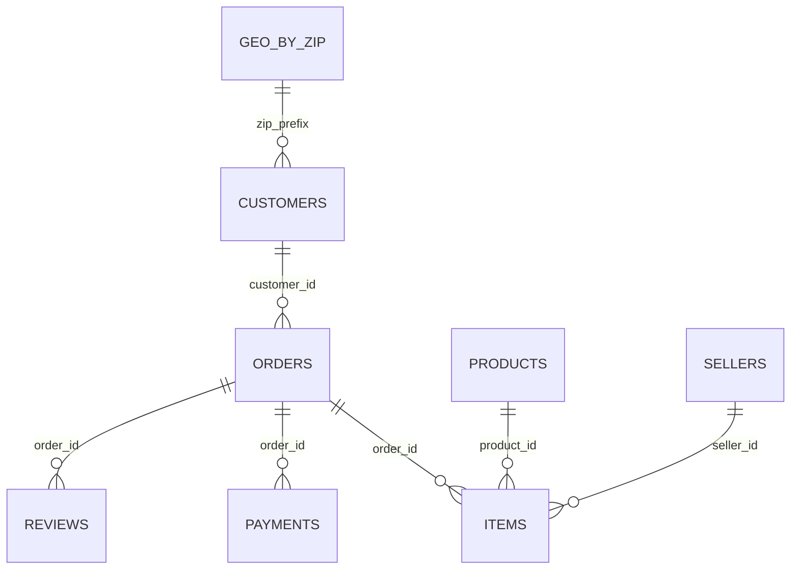

# Làm sạch và quản lý dữ liệu Olist bằng MongoDB

Môn ABDA433708 — nhóm 5, phần ETL/MongoDB.

## Nội dung

- clean_olist.py: làm sạch dữ liệu, giữ cờ chất lượng và tạo geo_by_zip.
- processed/: 9 bảng Olist sạch, geo_by_zip, audit_report.csv và manifest hash.
- Mongodb.js: kiểm tra điều kiện đầu vào, chuyển kiểu BSON và tạo index.
- mongodb/inspect_collections.js: kiểm tra database ở chế độ đọc.
- export_packages.py: xuất dữ liệu sạch và order_summary cho BI/ML/web; review trước mua bị loại khỏi trung bình, dữ liệu chi tiết giữ nguyên cờ.
- tests/: 6 kiểm thử Python cho export và kiểm thử JavaScript offline/mô phỏng.
- HUONG_DAN_BAN_GIAO.md, HUONG_DAN_BACKUP_RESTORE.md: quy trình sử dụng MongoDB và sao lưu.

## Cài đặt và chạy lại ETL

```powershell
python -m venv .venv
.\.venv\Scripts\python.exe -m pip install -r requirements.txt
.\.venv\Scripts\python.exe -B clean_olist.py --raw_dir "DUONG_DAN_9_CSV_OLIST_THO" --output_dir processed
```

Nguồn raw nằm trong phần thu thập Huy của repository chung: ../Huy_ThuThap_Olist/dataset/runs/20261019T171446Z_e35970/raw/olist. Bộ này không nhân bản thêm ZIP/raw; processed đã có sẵn để sử dụng và đối chiếu. Chạy các lệnh tại thư mục Thien_ETL_MongoDB. processed được giữ cùng phần Thiên để nộp và đối soát.

## Kiểm thử

```powershell
.\.venv\Scripts\python.exe -B -m unittest discover -s tests -p "test_export_packages.py" -v
node tests/test_mongodb_script.js
```

JavaScript test là offline; chạy trên database thật và backup/restore cần kiểm tra riêng, không suy ra từ mock.

## MongoDB và bàn giao

Import các CSV sạch vào database đã chọn, kiểm tra CONFIG.dbName rồi chạy Mongodb.js theo hướng dẫn. Không lưu URI có mật khẩu trong code. Export dùng MONGODB_URI qua biến môi trường, mặc định MongoDB local; ví dụ python export_packages.py --db BigData --output-dir handover.

Orders 99.441; items 112.650; geo_by_zip 19.015. KPI giao trễ chỉ dùng 95.097 đơn valid_delay_kpi=true. Không tự lấp ngày thiếu, không xóa đơn bất thường để làm đẹp KPI. Timestamp nguồn chưa xác nhận timezone. Review cùng ngày chưa rõ thứ tự giữ cờ để giải thích giới hạn.

audit_report.csv là kết quả kiểm định dữ liệu do pipeline tạo, thuộc sản phẩm ETL; không phải báo cáo rà soát nội bộ. Manifest dùng đối soát file. Không đưa dữ liệu tài khoản hoặc backup có credentials lên repo công khai.

Nguồn: Olist Brazilian E-Commerce (CC BY-NC-SA 4.0), https://www.kaggle.com/datasets/olistbr/brazilian-ecommerce . API IBGE trong phần thu thập của nhóm là nguồn tham chiếu địa lý.

## Kiểm chứng database và phục hồi

Đã kiểm chứng trên MongoDB Community 8.0.34 local, không phải Atlas: 10 collection, 1.569.937 document. evidence/database_verification.json lưu số dòng, index, 6 quan hệ và truy vấn explain. evidence/bson_validators.json là schema BSON thực tế. evidence/backup_restore.json ghi đối soát backup/restore: số dòng, BSON dbHash, index và validator khớp. Archive nằm trong dataset của ZIP nộp, không nhân bản file lớn lên Git.

Chạy tại gốc repository, với MONGODB_URI trỏ tới database của mình:

```powershell
python Thien_ETL_MongoDB/mongodb/import_clean.py --db BigData
mongosh "$env:MONGODB_URI/BigData" --file Thien_ETL_MongoDB/Mongodb.js
python Thien_ETL_MongoDB/mongodb/verify_database.py --db BigData --apply-validators --output verification.json
python Thien_ETL_MongoDB/mongodb/backup_restore.py --source-db BigData --restore-db BigData_restore_new --archive BigData_new.archive.gz --evidence restore_verification.json
```

Lệnh mongosh cần URI hợp lệ, không nối thêm /BigData nếu URI đã có database hoặc query string. Kiểm tra CONFIG.dbName trước khi chạy. Import từ chối collection không rỗng; backup từ chối archive đã có hoặc database đích đã tồn tại. Cài Database Tools để có mongodump/mongorestore trên PATH. Schema chỉ bật sau khi chuyển kiểu BSON.



Mối nối ZIP có thể thiếu tọa độ; không loại khách chỉ vì chưa nối được ZIP. customer_unique_id có thể xuất hiện ở nhiều customer_id. Tổng hợp item/payment/review riêng về order_id trước join cấp đơn.
